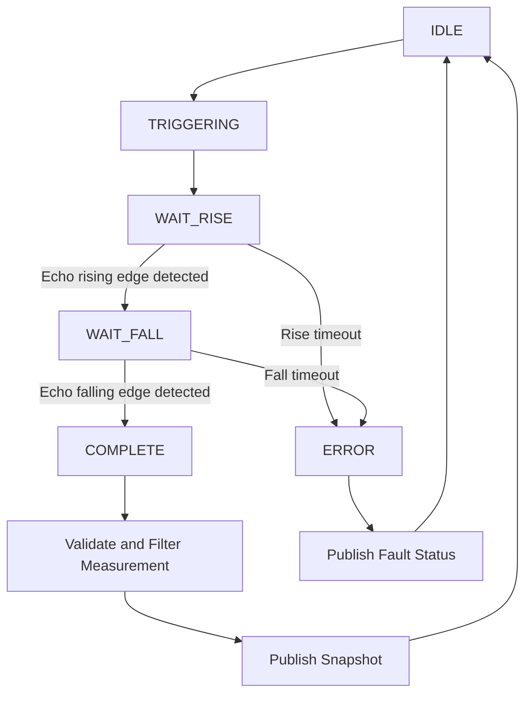
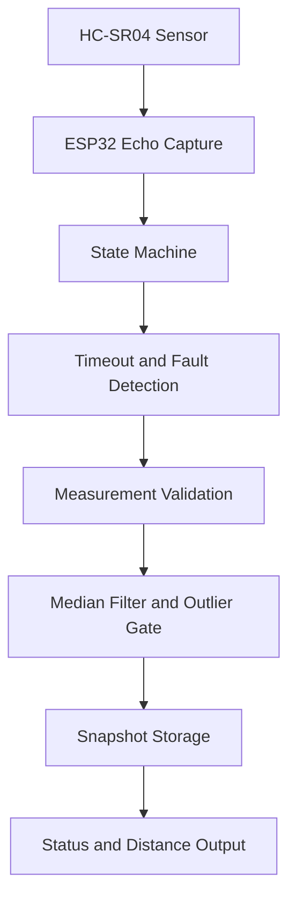

# ECHO SENTINEL
### A Distrustful Ultrasonic Sensor Driver

**Project:** Learn to Build a Real-Time Autonomous Mobile Robot Controller

## 1. Project Overview

Echo Sentinel is a reliability-focused ultrasonic sensor driver developed using an ESP32 and HC-SR04 ultrasonic sensor.

The system is designed to detect unreliable sensor behaviour instead of blindly trusting every measurement.

It identifies sensor faults, rejects sudden measurement outliers, detects stale readings, and provides consistent measurement snapshots.

## 2. Hardware and Software

- ESP32 DevKit V1
- HC-SR04 Ultrasonic Sensor
- Wokwi Simulator
- Arduino C++
- Visual Studio Code
- MinGW GCC for host-side tests

## 3. Circuit Connections

| HC-SR04 | ESP32 |
|---|---|
| VCC | VIN (5V) |
| GND | GND |
| TRIG | GPIO 5 |
| ECHO | GPIO 18 |

**Physical hardware note:** The HC-SR04 Echo output is 5V. Use a suitable voltage divider or level shifter before connecting it to the ESP32 GPIO.

## 4. Main Features

- Hardware-generated 10 µs trigger pulse using ESP32 RMT.
- Non-blocking sensor-driver architecture.
- Echo edge detection using interrupts.
- State-machine-based measurement process.
- Snapshot-based measurement access.
- Sequence-protected snapshot handling.
- Unsigned timer arithmetic for rollover handling.
- Median filter with N = 3.
- Outlier rejection threshold of 500 mm.
- Stale measurement detection.
- Consecutive invalid measurement fault detection.

## 5. Sensor Status Codes

| Status | Description |
|---|---|
| OK | Valid measurement |
| NO_ECHO_TIMEOUT | Echo rise was not detected in time |
| STUCK_HIGH | Echo signal remained high |
| STUCK_LOW | Repeated missing Echo signal |
| OUT_OF_RANGE | Measurement outside configured range |
| OUTLIER_REJECTED | Sudden abnormal measurement rejected |
| STALE | Measurement became too old |

The driver also tracks consecutive invalid measurements and raises a SENSOR_FAULT condition.

## 6. State Machine

The measurement process follows these states:

IDLE → TRIGGERING → WAIT_RISE → WAIT_FALL → COMPLETE / ERROR

Timeout handling prevents the driver from waiting indefinitely for an Echo signal.

## 7. Filtering and Measurement

- Median filter size: 3 samples.
- Outlier threshold: 500 mm.
- Configured measurement range: 20–4000 mm.
- Stale threshold: 150000 µs.
- Trigger interval: 60000 µs.

Distance conversion uses integer arithmetic with documented rounding in the firmware.

## 8. Testing and Verification

The project includes:

- Normal sensor measurement verification.
- No-Echo timeout testing.
- Stuck-high and stuck-low fault injection.
- Controlled outlier rejection and recovery.
- Sustained approach testing.
- Timer rollover arithmetic testing.
- Boundary-value testing.
- Stale-data testing.
- Host-side snapshot stress testing with 1,000,000 reads and writes.
- Trigger waveform verification using the Wokwi Logic Analyzer.
- Filter latency measurement.

**Verification note:** Host-side tests validate standalone test implementations of selected algorithms. They should not be interpreted as direct hardware verification of every ESP32 firmware path.

## 9. Project Folder Structure

```text
ECHO_SENTINEL/
│
├── Wokwi/
│   └── sketch.ino
│
├── Host_Tests/
│   ├── snapshot_stress_test.cpp
│   ├── boundary_test.cpp
│   ├── stale_test.cpp
│   ├── out_of_range_test.cpp
│   ├── outlier_test.cpp
│   └── rollover_test.cpp
│
├── Evidence/
│   └── Test screenshots and waveform files
│
└── README.md
```

## 10. How to Run

1. Open the Wokwi ESP32 project.
2. Load the firmware from `Wokwi/sketch.ino`.
3. Start the simulation.
4. Open the Serial Monitor.
5. Observe sensor readings and status messages.

Host-side tests can be compiled using:

```bash
g++ test_file.cpp -o test_file.exe
```

Run the executable from the terminal.

## 11. Project Objective

The primary objective of Echo Sentinel is to make ultrasonic sensor measurements more reliable by detecting faulty signals, rejecting suspicious readings, and preventing stale measurements from being treated as fresh data.


## 12. State Machine Diagram



## 13. System Architecture


